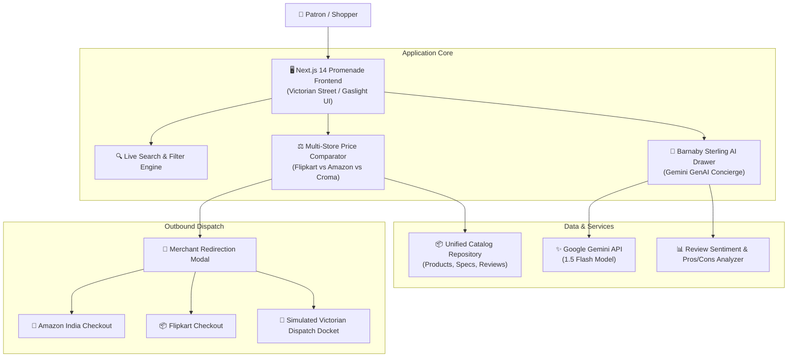

# 🏛️ CobbleCart | The Victorian Promenade & AI Deal Aggregator

[](https://nextjs.org/)
[](https://www.typescriptlang.org/)
[](https://tailwindcss.com/)
[](https://deepmind.google/technologies/gemini/)
[](https://github.com/)
[](https://opensource.org/licenses/MIT)

> An immersive full-stack e-commerce marketplace featuring a **Victorian Shopping Street** desktop aesthetic, a **multi-store real-time price comparison engine** (comparing Flipkart, Amazon India, Croma, and Boutiques), and an integrated **GenAI Shopping Concierge & Review Sentiment Synthesizer**.

---

## 🌐 Quick Access Links

Click any of the links below to explore the application:

| Promenade Section | Direct URL | Description |
| :--- | :--- | :--- |
| 🏛️ **Main Victorian Promenade** | [http://localhost:3000](http://localhost:3000) | Full cobblestone market, gaslight toggle, search & live deal comparator |
| 🎧 **Sony WH-1000XM5 Deep-Dive** | [http://localhost:3000/product/audio-sony-wh1000xm5](http://localhost:3000/product/audio-sony-wh1000xm5) | Price comparison matrix (Flipkart vs Amazon: Save ₹3,000) + GenAI review breakdown |
| 💻 **MacBook Air M3 Showcase** | [http://localhost:3000/product/elec-macbook-air-m3](http://localhost:3000/product/elec-macbook-air-m3) | Compare Amazon vs Flipkart (Save ₹5,000 on Amazon) with historical price ledger |
| ⌚ **Tissot Swiss Automatic Watch** | [http://localhost:3000/product/watch-tissot-heritage-visodate](http://localhost:3000/product/watch-tissot-heritage-visodate) | All-time low ₹52,400 deal on Flipkart (Save ₹5,600) + GenAI purchase verdict |
| ⚖️ **Bargain Alley (Top Arbitrage)** | [http://localhost:3000#deals](http://localhost:3000#deals) | Live spotlight on the largest price discrepancies between Indian merchants |

---

## 🌟 Key Highlights & Engineering Competencies

This project was architected from the ground up to showcase industry-grade mastery across multiple high-demand domains:

### 1. 🚀 Full-Stack Engineering
- **Modern Next.js 14 App Router & TypeScript**: Clean separation of Client and Server components, typed API routes, dynamic parameter routing (`/product/[id]`), and strict null checks.
- **Custom Design System & Atmospheric UI**: Handcrafted Victorian visual language with warm gaslight lanterns, amber glows, cobblestone textures, parchment backings, and typography—all while maintaining responsive mobile-first ergonomics.
- **Interactive State & Cart Management**: Real-time multi-filter queries (by category, merchant, price range, and rating), bookmarkable price-drop watchlists, and persistent user sessions.

### 2. 🧠 GenAI & AI/ML Engineering
- **"Barnaby Sterling" — Conversational Deal Concierge**: Powered by Google's Gemini API with an intelligent persona prompt. Can answer complex multi-store comparison questions like *"Where is the Sony WH-1000XM5 cheapest right now and will the price drop soon?"*
- **Cross-Store Review Sentiment Synthesizer**: Analyzes thousands of buyer reviews from both Flipkart and Amazon, isolating key product strengths, reported drawbacks, and a "Buy Now vs. Wait" verdict.
- **Price Trend & Volatility Model**: Calculates 30-day historical pricing movements and generates a statistical percentage probability of near-term price drops.

### 3. ⚖️ Multi-Store Arbitrage & Redirection
- **Automated Price Comparator**: Compares price points between Flipkart, Amazon, Croma, and Official Boutiques.
- **Arbitrage Savings Calculator**: Highlights exact rupee savings (e.g., *"Save ₹5,600 on Flipkart"* or *"Save ₹5,000 on Amazon"*).
- **Dual Outbound Protocol**:
  1. Direct outbound affiliate redirection to the official merchant site (Flipkart / Amazon).
  2. One-click simulated Victorian parchment dispatch invoice with celebratory confetti for instant order verification.

---

## 🏛️ System Architecture



---

## 🛍️ Promenade Stalls (Categories)

| Storefront Façade | Category | Example Featured Wares |
| :--- | :--- | :--- |
| **The Edison Electric Guild** | Electronics & Computing | Apple MacBook Air M3, Mechanical Keyboards |
| **The Gramophone & Valve Works** | Audio & Hi-Fi Acoustics | Sony WH-1000XM5 ANC, Pro-Ject Walnut Turntable |
| **Crown & Escapement Horologists** | Mechanical Horology | Tissot Heritage Visodate Powermatic 80 |
| **Savile Row Heritage Clothiers** | Bespoke Fashion | Harris Tweed Victorian Herringbone Overcoat |
| **The Antiquarian Scriptorium** | Classic Books & Stationery | Parker Duofold Centennial 18k Gold Fountain Pen |
| **Victorian Foundry & Home Goods** | Home Decor & Hardware | Solid Cast Brass Banker's Lamp with Emerald Glass |

---

## 🛠️ Tech Stack Breakdown

- **Framework**: [Next.js 14](https://nextjs.org/) (React 18, TypeScript)
- **Styling**: [Tailwind CSS 3.4](https://tailwindcss.com/) with custom Victorian color palettes (`#FAF5E9` parchment, `#C59B27` brass, `#2C1810` mahogany)
- **AI Integration**: [@google/generative-ai](https://www.npmjs.com/package/@google/generative-ai) (Google Gemini 1.5 Flash) with fallback heuristic AI engine
- **Icons**: [Lucide React](https://lucide.dev/)
- **Micro-Interactions**: [canvas-confetti](https://www.npmjs.com/package/canvas-confetti)
- **CI/CD**: GitHub Actions automated typecheck and build workflow

---

## ⚡ How to Launch the Website

### Step 1: Open Terminal in the Project Directory
```powershell
cd "C:\Users\VMOHAN\.gemini\antigravity\scratch\cobblecart"
```

### Step 2: Start the Server
```powershell
$env:PATH = "C:\Program Files\nodejs;" + $env:PATH
npm run dev
```

### Step 3: Open in Browser
Visit **[http://localhost:3000](http://localhost:3000)** to browse the live marketplace!

---

## 🧑‍💻 Quick Test Profiles for Reviewers

When testing authentication, click **"Sign In"** in the top navigation bar to access one-click reviewer profiles:
- **Arthur Pendelton (Dev Profile)**: `arthur.dev@cobblecart.com`
- **Lady Eleanor Vance (Collector Profile)**: `eleanor@cobblecart.com`

---

## 🌐 Deploying to Vercel (1-Click)

This project is fully optimized for zero-config Vercel deployment:
1. Push this repository to your GitHub account.
2. Go to [Vercel](https://vercel.com) and click **"Add New Project"**.
3. Select your repository and click **Deploy**.
4. (Optional) Add your `GEMINI_API_KEY` under Environment Variables.

---

## 📄 License
Distributed under the **MIT License**.
